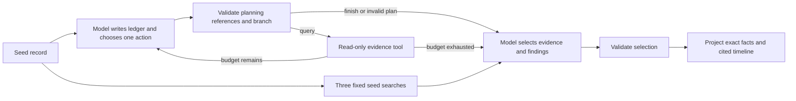

# TraceTrail

TraceTrail investigates a suspicious event in local CloudTrail JSON. It uses an Ollama model to choose evidence queries, tests alternative explanations, and builds a timeline with citations to exact records. LangChain supplies the model and tools. LangGraph controls the investigation state and query budget.

The application, inference, logs, traces, and evaluations run locally. It does not connect to AWS. It has no remediation or attack tools. The source repository is private while the release checks remain open.

## Run it

Use Python 3.11 or later, [uv](https://docs.astral.sh/uv/), and a local [Ollama](https://docs.ollama.com/) server at `127.0.0.1:11434`.

```sh
uv sync --frozen
uv run tracetrail demo --manifest evaluation/cases-v6.json --case dev-retention-chain
```

The default model is `qwen3.8:27b-q4_K_M`. The approved comparison models are `gemma4:31b-it-q4_K_M` and `mistral-small3.2:24b`. These tags must already resolve to local GGUF weights. TraceTrail checks raw Ollama metadata for remote routing, rejects other tags, ignores proxy settings and ambient API credentials, and disables HTTP redirects. It does not download models. Model use is sequential, with a process lock and an unload after each run. Stop other model sessions before a comparison.

The default demo writes `local-results/demo.json` with private file permissions. This directory is excluded from Git. The report contains the model's findings, exact field observations, a timeline, query history, errors, model metadata, and local execution traces. Failed model outputs remain visible. A new run uses a new filename when the requested result file already exists. An invalid or truncated output does not produce a replacement report.

```sh
uv run tracetrail query fixtures/v2/dev-role-pivot.json \
  --filter '{"event_name":"AssumeRole","limit":5}'
uv run tracetrail resolve fixtures/v2/dev-role-pivot.json \
  10000000-0000-4000-8000-000000000003
uv run tracetrail compare --manifest evaluation/cases-v6.json \
  --output local-results/comparison.json
uv run tracetrail local-evaluate local-results/comparison.json
```

To investigate your own file or directory, put the logs in the ignored `local-logs/` directory. Supply a seed event ID, a question, and a local JSON list of hypotheses. Each hypothesis needs a `claim_id` and a `statement`; it must not contain an answer label.

```sh
uv run tracetrail investigate local-logs/cloudtrail/ \
  --seed EVENT_ID --question 'What does this activity establish?' \
  --hypotheses local-logs/hypotheses.json
```

Keep the hypotheses file outside a directory that you pass as a CloudTrail input. The store expects each input JSON file to contain a `Records` array. Query tools make exact matches on identity, caller access key, issued access key, session issuer, source address, event name, and time. `issued_access_key` finds the STS record whose `responseElements.credentials.accessKeyId` matches a temporary key. Inputs have size and event budgets. A query returns at most 20 records and reports truncation. To fetch another page, submit its `next_offset` with the same filters. Each page uses one query. No query text is executed as code.

## Evidence and conclusions

Each record has a citation of the form `sha256:<original file hash>/Records/<zero-based index>`. The store can resolve this citation to the exact original JSON record. Duplicate event IDs are rejected. The model uses short aliases while it works; the application resolves each alias back to the full citation before validation. This reduces token use without changing the evidence.

An investigation can use at most three evidence queries and four model calls, with a 3,200-token output allowance per call. Its state includes collected records, tool errors, query reasons, and raw model outputs. The supplied seed is available before the first query. The model can finish early. Returned evidence is presented in UTC timestamp order with signed seconds from the seed: negative means before it, and positive means after it. Citation aliases remain stable when an earlier record is retrieved later. Timestamp order does not establish causality.

The model selects relevant records and writes an `evidence_links` list for each unchanged hypothesis. Each link names a selected citation, exact field paths, and a role: `supports`, `contradicts`, or `context`. The finding also includes a brief rationale, specific missing evidence, and a `supported`, `refuted`, or `uncertain` status. Supported and refuted findings require the corresponding link role; uncertainty requires an explicit evidence gap. The wire schema forbids separate finding citations and field observations. Code derives public citations only from the model's explicit links.

After selection and link validation, code extracts exact typed facts from the selected returned records. It checks that linked citations and field paths resolve, but does not verify that the evidence entails the finding. Roles, rationales, gaps, statuses, and narrative remain model judgments. Code does not add missing links, select relevance, repair statuses, or retry an invalid report. `observation_source` and `validation_scope` identify this boundary in the saved report. A valid report structure does not establish semantic truth.

Projection preserves whole arrays, empty objects, and actual JSON nulls. Missing top-level `errorCode`, `errorMessage`, `requestParameters`, and `responseElements` fields receive explicit `present: false` observations with a null value. A field that exists with JSON null uses `present: true`. Projection allows at most 2,000 observations, 1,000,000 bytes of compact ASCII-escaped JSON, nesting depth 32, and field paths of 512 characters. Limit failures or ambiguous dotted keys in traversed objects make the report invalid; facts are not silently truncated. The same projection applies to all methods and models.

Projection includes every supported root field in the selected JSON records and applies no credential redaction. Sensitive input values can appear in the `0600` reports and raw traces. Handle these local files according to the data they contain.

A correct citation alone does not establish that a conclusion is true. CloudTrail API activity does not prove a person's intent, approval, credential theft, or an external data transfer. Missing records do not establish that an incident did not occur. Narrative limitations require human review.

Before each action, the planner writes a ledger for every supplied hypothesis. It names returned evidence, an open question, candidate filters, and actual query attempt IDs. The candidate inventory derives only from returned records and recorded query scopes. It never searches the store or selects events for the report. The model can choose one observed candidate, one custom query, one pending page, or an exact event lookup. Code executes only that choice. A candidate uses its exact filter with a limit of 20; a continuation keeps the earlier filters and page limit.

The model can finish with unused queries. It must account for every visible candidate and pending page, including already queried candidates, as deferred, not relevant, or tested under a recorded scope. A tested candidate needs an actual successful matching query; a pending page cannot count as tested. This accounting checks references and attempted scopes, not the truth of the model's explanation or completeness of the investigation. An invalid plan stops further tools and preserves its raw output and errors. A later valid report does not clear the invalid planning status. Filters, time bounds, errors, pagination, decisions, and the stop reason remain visible.



## Local tracing and evaluation

Each investigation captures real LangChain/LangGraph execution spans in a local callback collector. The LangSmith SDK can also score the saved outputs with `evaluate(upload_results=False)`. The offline evaluation recomputes the annotated metrics and writes SDK evaluation traces and feedback beside the input file. It replays saved outputs and makes no new inference calls.

Local trace files and offline SDK evaluation are the project's LangSmith integration. They need no LangSmith account, API key, hosted project, or server. TraceTrail disables ambient and inherited tracing settings, and the offline SDK client rejects HTTP requests. The separate LangSmith server and web UI are outside this local project's scope. See [verified integration details](docs/integrations.md).

## Compare methods and models

The [frozen synthetic suites](evaluation/README.md) preserve their exact fixtures and annotations. The current v6 suite has two development cases and two held-out cases, frozen before protocol v7 inference. Earlier suites are exposed regression data. The CLI's default comparison still uses v2 for compatibility; pass `--manifest evaluation/cases-v6.json` to select v6. All events, accounts, credentials, and names are invented. The fixtures represent API sequences, not real incidents. Earlier fixture bytes and measured results remain available. See [CloudTrail semantics and limits](docs/cloudtrail.md).

The adaptive method lets the model choose queries. The fixed method always searches the seed identity, source address, and access key in a one-hour window on each side of the seed. Both methods use the same evidence tools, record limits, report prompt, and report schema. The adaptive method also makes planning calls. Those calls count toward its latency and model cost. All three models receive the same frozen prompts, cases, schemas, and budgets. Qwen is the reference for the method comparison.

The frozen [v7 protocol fingerprint](evaluation/protocol-v7.json) records source, schema, prompt, and manifest hashes. V7 adds hypothesis ledgers, explicit query choices, and finish accounting. Reporting, local fact projection, fixed searches, the scorer, and budgets retain the v6 contract. Planning instructions, catalog, schema, and validation change together, so their effects cannot be isolated. Runtime validation receives no answer annotations or case-specific support rules.

The October 17 v7 comparison ran four cases per group, two per split. Ten of 16 investigations completed structural checks; six processes were invalid. All raw means below retain those invalid runs.

| Model and method | Valid processes | Mean selected-event recall | Raw strict support | Primary declared field coverage |
| --- | --- | --- | --- | --- |
| Qwen adaptive | 3/4 | 87.50% | 81.25% | 23/43 |
| Qwen fixed | 4/4 | 50.00% | 18.75% | 17/43 |
| Gemma adaptive | 3/4 | 70.83% | 56.25% | 17/43 |
| Mistral adaptive | 0/4 | 54.17% | 31.25% | 0/43 |

Thirty-four of 64 findings failed strict support checks. Raw strict support uses globally projected facts, including retained reports from invalid processes; it does not prove complete model-authored links or valid planning. Primary field coverage counts only completed, valid processes, while keeping every required field in the denominator: 57/172 overall. Mistral matched every status label despite all four processes being invalid. Correct labels do not establish sound reasoning.

The [Qwen evidence review](docs/v7-evidence-review.md) documents incomplete searches, an invalid claim that a key-use pivot was tested by an issuance query, and incorrect prose about remaining budget. It is an assistant source review, not independent human review. These four synthetic cases establish no model winner or production reliability. New cases and annotations also prevent a cross-suite improvement claim. The fixed control is a simple seed-based search within one hour on each side of the seed. See [v7 results](evaluation/results-v7.json), the [evaluation guide](evaluation/README.md), and [measured progress](docs/progress.md) for split scores, query cost, local SDK evidence, and preserved failures.

The October 15 [v5 results](evaluation/results-v5.json) and October 16 [v6 results](evaluation/results-v6.json) remain preserved with their dated analysis in the evaluation guide and progress record.

Metrics cover relevant-event precision and recall, exact evidence support for fixed propositions, unsupported assertions, insufficient evidence, tool errors, query count, model calls, and latency. The scorer checks the required records and field observations for each proposition. It does not act as a general natural-language judge. Saved failures stay in the evaluation denominator. A small synthetic suite cannot establish production reliability.

## Check the code

```sh
uv run ruff check .
uv run ruff format --check .
uv run pytest -q
```

Unit tests use clearly marked test-only models. They verify budgets, evidence integrity, failures, local transport, and offline evaluation. They are separate from real Ollama capability evidence. CI runs these checks without a model or cloud inference. [Progress and release checks](docs/progress.md) record the actual local runs and remaining work.
