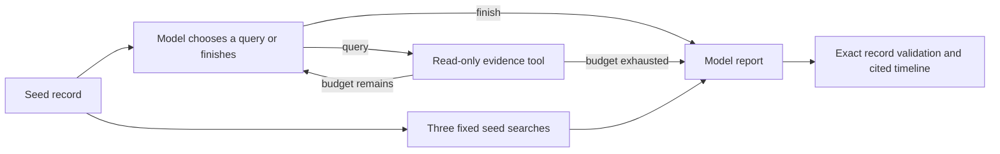

# TraceTrail

TraceTrail investigates a suspicious event in local CloudTrail JSON. It uses an Ollama model to choose evidence queries, tests alternative explanations, and builds a timeline with citations to exact records. LangChain supplies the model and tools. LangGraph controls the investigation state and query budget.

The application, inference, logs, traces, and evaluations run locally. It does not connect to AWS. It has no remediation or attack tools. The source repository is private while the release checks remain open.

## Run it

Use Python 3.11 or later, [uv](https://docs.astral.sh/uv/), and a local [Ollama](https://docs.ollama.com/) server at `127.0.0.1:11434`.

```sh
uv sync --frozen
uv run tracetrail demo --manifest evaluation/cases-v3.json --case dev-caller-and-child-pivot
```

The default model is `qwen3.8:27b-q4_K_M`. The approved comparison models are `gemma4:31b-it-q4_K_M` and `mistral-small3.2:24b`. These tags must already resolve to local GGUF weights. TraceTrail checks raw Ollama metadata for remote routing, rejects other tags, ignores proxy settings and ambient API credentials, and disables HTTP redirects. It does not download models. Model use is sequential, with a process lock and an unload after each run. Stop other model sessions before a comparison.

The default demo writes `local-results/demo.json` with private file permissions. This directory is excluded from Git. The report contains the model's findings, exact field observations, a timeline, query history, errors, model metadata, and local execution traces. Failed model outputs remain visible. A new run uses a new filename when the requested result file already exists. An invalid or truncated output does not produce a replacement report.

```sh
uv run tracetrail query fixtures/v2/dev-role-pivot.json \
  --filter '{"event_name":"AssumeRole","limit":5}'
uv run tracetrail resolve fixtures/v2/dev-role-pivot.json \
  10000000-0000-4000-8000-000000000003
uv run tracetrail compare --output local-results/comparison.json
uv run tracetrail local-evaluate local-results/comparison.json
uv run tracetrail compare --manifest evaluation/cases-v3.json \
  --output local-results/fresh-comparison.json
```

To investigate your own file or directory, put the logs in the ignored `local-logs/` directory. Supply a seed event ID, a question, and a local JSON list of hypotheses. Each hypothesis needs a `claim_id` and a `statement`; it must not contain an answer label.

```sh
uv run tracetrail investigate local-logs/cloudtrail/ \
  --seed EVENT_ID --question 'What does this activity establish?' \
  --hypotheses local-logs/hypotheses.json
```

Keep the hypotheses file outside a directory that you pass as a CloudTrail input. The store expects each input JSON file to contain a `Records` array. Query tools make exact matches on identity, caller access key, issued access key, session issuer, source address, event name, and time. `issued_access_key` finds the STS record whose `responseElements.credentials.accessKeyId` matches a temporary key. Inputs have size and event budgets. A query returns at most 20 records and reports truncation. To fetch another page, submit its `next_offset` with the same filters. Each page uses one query. No query text is executed as code.

## Evidence and conclusions

Each record has a citation of the form `sha256:<original file hash>/Records/<zero-based index>`. The store can resolve this citation to the exact original JSON record. Duplicate event IDs are rejected. The model uses short aliases while it works; the application resolves each alias back to the full citation before validation. This reduces token use without changing the evidence.

An investigation can use at most three evidence queries and four model calls. Its state includes collected records, tool errors, query reasons, and model outputs. The supplied seed is available before the first query. The model can finish early. The final timeline uses observed timestamps in UTC order. Atomic field observations must equal the cited record, including JSON value types. A missing field uses `present: false` with a null value. A field that exists with a JSON null uses `present: true`. The model must preserve each supplied hypothesis statement and mark it `supported`, `refuted`, or `uncertain`.

A correct citation alone does not establish that a conclusion is true. CloudTrail API activity does not prove a person's intent, approval, credential theft, or an external data transfer. Missing records do not establish that an incident did not occur. Narrative limitations require human review.

The planner sees candidate filters derived from returned records and the scopes of queries it attempted. This inventory never searches the store or selects events for the report. The model can investigate earlier caller activity, later use of a returned key, or the event that issued an observed key. A searched filter does not imply complete coverage. Filters, time bounds, errors, pagination, and remaining candidates stay visible in the report.



## Local tracing and evaluation

Each investigation captures real LangChain/LangGraph execution spans in a local callback collector. The LangSmith SDK can also score the saved outputs with `evaluate(upload_results=False)`. The offline evaluation recomputes the annotated metrics and writes SDK evaluation traces and feedback beside the input file. It replays saved outputs and makes no new inference calls.

Hosted tracing is disabled, including ambient tracing settings and inherited callbacks. The offline SDK client cannot use HTTP. No key or account is needed. This is local trace storage and SDK evaluation. A full LangSmith server and web UI are not included. The official self-hosted server requires an Enterprise add-on license. See [verified integration details](docs/integrations.md).

## Compare methods and models

The [frozen synthetic suites](evaluation/README.md) preserve their exact fixtures and annotations. All four earlier v2 cases are now exposed regression data. The new v3 suite has one development case and one held-out case, frozen before protocol v4 inference. It tests caller context outside a one-hour window, changed source addresses, returned-key activity, and reverse key-issuance lookup. All events, accounts, credentials, and names are invented. The fixtures represent API sequences, not real incidents. V2's field corrections and the original v1 bytes remain available for historical results. See [CloudTrail semantics and limits](docs/cloudtrail.md).

The adaptive method lets the model choose queries. The fixed method always searches the seed identity, source address, and access key in a one-hour window on each side of the seed. Both methods use the same evidence tools, record limits, report prompt, and report schema. The adaptive method also makes planning calls. Those calls count toward its latency and model cost. All three models receive the same frozen prompts, cases, schemas, and budgets. Qwen is the reference for the method comparison.

The [v4 protocol fingerprint](evaluation/protocol-v4.json) records source, schema, prompt, and manifest hashes. V4 changes query capabilities, instructions, and the report token allowance together. A comparison cannot isolate the contribution of one change. Results on the fresh suite remain small-sample evidence, even when every report validates.

Metrics cover relevant-event precision and recall, exact evidence support for fixed propositions, unsupported assertions, insufficient evidence, tool errors, query count, model calls, and latency. The scorer checks the required records and field observations for each proposition. It does not act as a general natural-language judge. Saved failures stay in the evaluation denominator. A small synthetic suite cannot establish production reliability.

## Check the code

```sh
uv run ruff check .
uv run ruff format --check .
uv run pytest -q
```

Unit tests use clearly marked test-only models. They verify budgets, evidence integrity, failures, local transport, and offline evaluation. They are separate from real Ollama capability evidence. CI runs these checks without a model or cloud inference. [Progress and release checks](docs/progress.md) record the actual local runs and remaining work.
