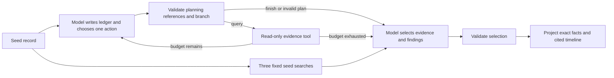

# TraceTrail

TraceTrail investigates a suspicious event in local CloudTrail JSON. It uses an Ollama model to choose evidence queries, tests alternative explanations, and builds a timeline with citations to exact records. LangChain supplies the model and tools. LangGraph controls the investigation state and query budget.

TraceTrail is an experimental portfolio project. It can make unsupported conclusions and stop before it has checked useful evidence. Published evaluation fixtures are synthetic. See the [measured limitations and known failures](docs/model-pilot-results.md). Its reports require source review; it has not been validated for production incident response.

The application, inference, logs, traces, and evaluations run locally. It does not connect to AWS. It has no remediation or attack tools.

## Run it

Use Python 3.11 or later, [uv](https://docs.astral.sh/uv/), and a local [Ollama](https://docs.ollama.com/) server at `127.0.0.1:11434`.

```sh
uv sync --frozen
uv run tracetrail demo --manifest evaluation/cases-v7.json --case dev-role-duration-direction
```

The default model is `qwen3.8:27b-q4_K_M`. The approved local cohort also includes `gemma4:e2b-it-q4_K_M`, `gemma4:12b-it-q4_K_M`, `gemma4:31b-it-q4_K_M`, and `mistral-small3.2:24b`. See the [exact model deployments](docs/model-cohort.md). These tags must already resolve to local GGUF weights. TraceTrail checks raw Ollama metadata for remote routing, rejects other tags, ignores proxy settings and ambient API credentials, and disables HTTP redirects. It does not download models. Model use is sequential, with a process lock and an unload after each run. Stop other model sessions before a comparison.

The default demo writes `local-results/demo.json` with private file permissions. This directory is excluded from Git. The report contains the model's findings, exact field observations, a timeline, query history, errors, model metadata, and local execution traces. Failed model outputs remain visible. A new run uses a new filename when the requested result file already exists. An invalid or truncated output does not produce a replacement report.

```sh
uv run tracetrail query fixtures/v2/dev-role-pivot.json \
  --filter '{"event_name":"AssumeRole","limit":5}'
uv run tracetrail resolve fixtures/v2/dev-role-pivot.json \
  10000000-0000-4000-8000-000000000003
uv run tracetrail compare --manifest evaluation/cases-v7.json \
  --output local-results/comparison.json
uv run tracetrail local-evaluate local-results/comparison.json
```

To investigate your own file or directory, put the logs in the ignored `local-logs/` directory. Supply a seed event ID, a question, and a local JSON list of hypotheses. Each hypothesis needs a `claim_id` and a `statement`; it must not contain an answer label.

```sh
uv run tracetrail investigate local-logs/cloudtrail/ \
  --seed EVENT_ID --question 'What does this activity establish?' \
  --hypotheses local-logs/hypotheses.json
```

Keep the hypotheses file outside a directory that you pass as a CloudTrail input. The store expects each input JSON file to contain a `Records` array. Query tools make exact matches on identity, caller access key, issued access key, session issuer, source address, event name, and time. `issued_access_key` finds records whose `responseElements.credentials.accessKeyId` matches the requested value. It does not infer issuance from an event name. Inputs have size and event budgets. A query returns at most 20 records and reports truncation. To fetch another page, submit its `next_offset` with the same filters. Each page uses one query. No query text is executed as code.

## Evidence and conclusions

Each record has a citation of the form `sha256:<original file hash>/Records/<zero-based index>`. The store can resolve this citation to the exact original JSON record. Duplicate event IDs are rejected. The model uses short aliases while it works; the application resolves each alias back to the full citation before validation. This reduces token use without changing the evidence.

An investigation can use at most three evidence queries and four model calls, with a 3,200-token output allowance per call. Its state includes collected records, tool errors, query reasons, and raw model outputs. The supplied seed is available before the first query. The model can finish early. Returned evidence is presented in UTC timestamp order with signed seconds from the seed: negative means before it, and positive means after it. Citation aliases remain stable when an earlier record is retrieved later. Timestamp order does not establish causality.

The model selects relevant records and writes an `evidence_links` list for each unchanged hypothesis. Each link names a selected citation, exact field paths, and a role: `supports`, `contradicts`, or `context`. The finding also includes a brief rationale, specific missing evidence, and a `supported`, `refuted`, or `uncertain` status. Supported and refuted findings require the corresponding link role; uncertainty requires an explicit evidence gap. The wire schema forbids separate finding citations and field observations. Code derives public citations only from the model's explicit links.

After selection and link validation, code extracts exact typed facts from the selected returned records. It checks that linked citations and field paths resolve, but does not verify that the evidence entails the finding. Roles, rationales, gaps, statuses, and narrative remain model judgments. Code does not add missing links, select relevance, repair statuses, or retry an invalid report. `observation_source` and `validation_scope` identify this boundary in the saved report. A valid report structure does not establish semantic truth.

Projection preserves whole arrays, empty objects, and actual JSON nulls. Missing top-level `errorCode`, `errorMessage`, `requestParameters`, and `responseElements` fields receive explicit `present: false` observations with a null value. A field that exists with JSON null uses `present: true`. Projection allows at most 2,000 observations, 1,000,000 bytes of compact ASCII-escaped JSON, nesting depth 32, and field paths of 512 characters. Limit failures or ambiguous dotted keys in traversed objects make the report invalid; facts are not silently truncated. The same projection applies to all methods and models.

Projection includes every supported root field in the selected JSON records and applies no credential redaction. Sensitive input values can appear in the `0600` reports and raw traces. Handle these local files according to the data they contain.

A correct citation alone does not establish that a conclusion is true. CloudTrail API activity does not prove a person's intent, approval, credential theft, or an external data transfer. Missing records do not establish that an incident did not occur. Narrative limitations require human review.

Before each action, the planner writes a ledger for every supplied hypothesis. It names returned evidence, an open question, candidate filters, and actual query attempt IDs. The candidate inventory derives only from returned records and recorded query scopes. It never searches the store or selects events for the report. The model can choose one observed candidate, one custom query, one pending page, or an exact event lookup. Code executes only that choice. A candidate uses its exact filter with a limit of 20; a continuation keeps the earlier filters and page limit.

An observed credential map separates keys that signed requests from keys returned in responses. Each occurrence has an exact citation and field path. The map shows existing use and issuance lookup IDs and their actual query scopes. It reads only returned evidence, preserves literal identity types, and discloses its limits. It does not predict matching records, choose queries, identify a human operator, or establish causality. Both methods receive this same context.

The model can finish with unused queries. It must account for every visible candidate and pending page, including already queried candidates, as deferred, not relevant, or tested under a recorded scope. A tested candidate needs an actual successful matching query; a pending page cannot count as tested. This accounting checks references and attempted scopes, not the truth of the model's explanation or completeness of the investigation. An invalid plan stops further tools and preserves its raw output and errors. A later valid report does not clear the invalid planning status. Filters, time bounds, errors, pagination, decisions, and the stop reason remain visible.

The saved `termination` object reports query use, remaining budget and stop reason from graph counters. Model explanations remain unverified. A model finish with one query left is not budget exhaustion.



## Local tracing and evaluation

Each investigation captures real LangChain/LangGraph execution spans in a local callback collector. The LangSmith SDK can also score the saved outputs with `evaluate(upload_results=False)`. The offline evaluation recomputes the annotated metrics and writes SDK evaluation traces and feedback beside the input file. It replays saved outputs and makes no new inference calls.

New batches explicitly select `claim-support-v1`. This scorer checks each finding's own field links against exact selected, returned source records and typed annotations. Global projected facts cannot fill missing links. Raw support and process-valid primary support stay separate; invalid runs earn zero primary credit and keep their denominators. Historical `metrics` retain the original scorer. New values use `claim_support_metrics`, with separate prefixed SDK feedback and a scorer source fingerprint. See the [measurement contracts](docs/measurement.md). Exact annotation support still does not prove semantic correctness.

Local trace files and offline SDK evaluation are the project's LangSmith integration. They need no LangSmith account, API key, hosted project, or server. TraceTrail disables ambient and inherited tracing settings, and the offline SDK client rejects HTTP requests. The separate LangSmith server and web UI are outside this local project's scope. See [verified integration details](docs/integrations.md).

## Compare methods and models

The [frozen synthetic suites](evaluation/README.md) preserve exact fixtures and annotations. The current v7 suite has two development cases and two held-out cases, independently authored and frozen before protocol v8 inference. All earlier suites are exposed regression data. Original split labels remain historical after exposure. The CLI default still uses v2 for compatibility; pass `--manifest evaluation/cases-v7.json` to select v7. All events, accounts, credentials and names are invented. The fixtures represent API sequences, not real incidents. Earlier fixture bytes and measured results remain available. See [CloudTrail semantics and limits](docs/cloudtrail.md).

The adaptive method lets the model choose queries. The fixed method always searches the seed identity, source address, and access key in a one-hour window on each side of the seed. Both methods use the same evidence tools, record limits, report prompt, and report schema. The adaptive method also makes planning calls. Those calls count toward its latency and model cost. Each model within a frozen comparison receives the same application prompts, cases, schemas, and budgets. Qwen is the reference for the method comparison.

The October 19 [five-model development pilot](docs/model-pilot-results.md) ran 40 actual investigations on two exposed synthetic cases, with both methods within every model and two paired repeats. It used 90 model calls and 94 tool calls. Twenty-two processes passed structural checks; all 18 invalid attempts remain. The real offline LangSmith SDK replay produced 840 feedback values, verified against the saved outputs.

Each row below has four assignments and 16 requested claim slots. Source-aware assistant review separates warranted definite conclusions from false and unsupported ones. Proper uncertainty has separate categories in the full report; these counts are not an accuracy score.

| Model and method | Valid processes | Warranted definite | False definite | Unsupported definite | Mean cell seconds |
| --- | --- | ---: | ---: | ---: | ---: |
| Gemma E2B adaptive | 0/4 | 0 | 0 | 4 | 15.90 |
| Gemma E2B fixed | 0/4 | 2 | 2 | 4 | 11.87 |
| Gemma 12B adaptive | 2/4 | 6 | 2 | 0 | 130.79 |
| Gemma 12B fixed | 4/4 | 2 | 2 | 0 | 35.31 |
| Qwen 27B adaptive | 4/4 | 8 | 2 | 0 | 219.20 |
| Qwen 27B fixed | 4/4 | 2 | 0 | 0 | 68.28 |
| Mistral 24B adaptive | 2/4 | 8 | 2 | 0 | 144.70 |
| Mistral 24B fixed | 0/4 | 2 | 0 | 0 | 44.58 |
| Gemma 31B adaptive | 2/4 | 12 | 0 | 0 | 279.15 |
| Gemma 31B fixed | 4/4 | 2 | 0 | 0 | 64.67 |

The complete review also records 2 avoidable uncertainties, 56 retrieval-limited unknowns and 40 source-limited unknowns. Only 6/160 findings meet the complete primary field-link contract, covering 124/520 required atoms in valid processes. A semantic conclusion and complete declared support are separate measurements. The [per-cell numeric results](evaluation/results-model-pilot-v1.json) retain failures, paired differences, resource measurements, review disagreements and artifact hashes. The [review limitations](docs/model-pilot-results.md#review-provenance-and-limitations) disclose a corrected preliminary review draft and the absence of independent human validation.

See the [reproduction guide](docs/model-pilot.md) and [proposed fresh-case study](docs/benchmark-plan.md). Same-seed repeats measure observed stability; two exposed case clusters and parameter counts do not establish intelligence, a model winner or production reliability. Historical comparisons below retain their original assignments.

The frozen [v8 protocol fingerprint](evaluation/protocol-v8.json) records 13 source files, eight schemas, the prompt, scorer and manifest hashes. V8 adds the observed credential map and a short direction-specific planning instruction. Report instructions, schemas, exact projection, fixed searches, budgets and the historical scorer retain their prior contracts. Both methods receive the added context. The map and instruction change together, so their effects cannot be isolated. Runtime validation receives no answer annotations or case-specific support rules.

The October 18 v8 comparison ran 16 actual local investigations on four new synthetic cases, with two cases per split and one repeat per cell. 10 processes completed structural checks. All failures remain in the denominators.

| Model and method | Valid processes | Mean raw selected-event precision / recall | Complete primary claim contracts | Primary required atoms | Mean queries | Mean seconds |
| --- | --- | --- | --- | --- | --- | --- |
| Qwen adaptive | 3/4 | 100.00% / 81.25% | 3/16 | 24/51 | 2.00 | 214.93 |
| Qwen fixed | 4/4 | 100.00% / 45.83% | 2/16 | 23/51 | 3.00 | 62.73 |
| Gemma adaptive | 2/4 | 100.00% / 93.75% | 1/16 | 17/51 | 2.50 | 267.29 |
| Mistral adaptive | 1/4 | 75.00% / 50.00% | 0/16 | 5/51 | 2.00 | 133.29 |

Primary support uses the new finding-level contract. It counts only a corresponding finding's explicit source links in a valid process. All 204 required atoms remain in the denominator; 69 receive primary credit. Complete claim contracts additionally require the fixed statement, status and all required records and atoms. These counts are not a semantic accuracy or hallucination measure. Legacy metrics remain separately available. Selected-event precision and recall are raw means that include invalid processes. Primary claim and atom credit is process-gated.

The credential map does not establish a planning improvement. Source review found early stopping, false query-scope and budget explanations, incomplete field links, and semantic errors. The [assistant evidence review](docs/v8-evidence-review.md) separates these failures from correct uncertainty. It is not independent human review. Four cases cannot establish a model winner, a broad adaptive advantage, or production reliability. The fixed control is three seed searches within one hour on each side of the seed. See [v8 results](evaluation/results-v8.json), the [evaluation guide](evaluation/README.md), and [measured progress](docs/progress.md). Earlier results and reviews remain preserved.

The October 15 [v5 results](evaluation/results-v5.json) and October 16 [v6 results](evaluation/results-v6.json) remain preserved with their dated analysis in the evaluation guide and progress record.

Metrics cover relevant-event precision and recall, fixed annotation support, insufficient-evidence labels, tool errors, query count, model calls, and latency. Annotation support failures are not a count of hallucinations. The scorer does not act as a general natural-language judge; free prose and evidence roles need source review. Saved failures stay in the evaluation denominator. A small synthetic suite cannot establish production reliability.

## Check the code

```sh
uv run ruff check .
uv run ruff format --check .
uv run pytest -q
```

Unit tests use clearly marked test-only models. They verify budgets, evidence integrity, failures, local transport, and offline evaluation. They are separate from real Ollama capability evidence. CI runs these checks without a model or cloud inference. [Progress and release checks](docs/progress.md) record the actual local runs and remaining work.

The current suite has 50 collected cases, including parameter variants. A
collection guard rejects more than 50. See the [test inventory and coverage
tradeoffs](docs/test-coverage.md) for the reduction from 734 cases. Historical
benchmark test counts describe the earlier revisions; model measurements and
their artifacts remain unchanged.
